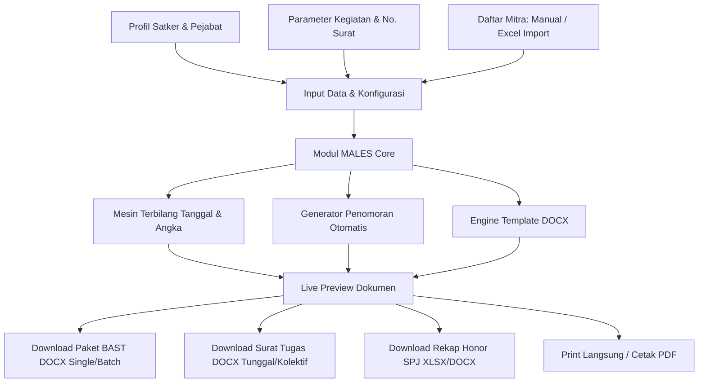

# PRODUCT REQUIREMENTS DOCUMENT (PRD)

---

## 1. INFORMASI DOKUMEN & IDENTITAS PRODUK

| Atribut | Keterangan |
| :--- | :--- |
| **Nama Aplikasi** | **MALES** (*Manajemen Administrasi Lebih Efektif dan Sederhana*) |
| **Singkatan / Tagline** | *Aplikasi Otomatisasi Berkas Administrasi Pencairan Honor Mitra Bebas Ribet & Sederhana* |
| **Instansi Referensi** | Badan Pusat Statistik (BPS) Satuan Kerja 7301 (BPS Kabupaten Kepulauan Selayar) |
| **Target Deployment** | **GitHub Pages** (Repository: `males`) |
| **Arsitektur Sistem** | Static Web Application (Client-Side Only / Jamstack / Zero-Server Backend) |
| **Versi Dokumen** | 1.0.0 |
| **Status Dokumen** | Final Draft / Ready for Implementation |

---

## 2. LATAR BELAKANG & TUJUAN PRODUK

### 2.1 Masalah Saat Ini (Problem Statement)
Setiap siklus bulanan, triwulanan, atau tahunan di BPS (seperti pada survei VHTS, SHPB, SHP, Susenas, Sakernas, SPUNP, Sutas, dll.), Tim Kerja harus memproses berkas administrasi pencairan honor untuk puluhan hingga ratusan mitra statistik.

Berdasarkan telaah riil pada dokumen kerja pencairan survei VHTS di satker 7301, proses administrasi saat ini masih menghadapi kendala operasional:
1. **Pekerjaan Manual Berulang (*Copy-Paste Overhead*)**: Pembuatan Surat Tugas (ST) dan Berita Acara Serah Terima (BAST) masih dilakukan dengan mengedit file Word (`.docx`) satu per satu per mitra atau per bulan.
2. **Rawan Kesalahan Manusia (*Human Error*)**:
   - Ketidaksesuaian nomor surat antara Surat Tugas dan BAST.
   - Inkonsistensi teks kalimat pembuka terbilang hari, tanggal, bulan, dan tahun pada BAST (misal: penulisan tanggal `"Pada hari ini senin, tanggal dua puluh bulan juli tahun dua ribu dua puluh enam (20-7-2026)"`).
   - Ketidakcocokan antara target sampel dan realisasi dokumen yang diserahkan.
   - Kesalahan pengetikan NIK / ID Mitra dan ejaan nama mitra.
3. **Waktu Pembuatan Lama (*Time-Consuming*)**: Membuat BAST untuk 10–50 mitra membutuhkan waktu berjam-jam hanya untuk mengganti nama, NIP/ID Mitra, jumlah dokumen, dan nomor urut BAST.
4. **Ketiadaan Server Khusus**: Kantor daerah/satker sering kali tidak memiliki server backend mandiri atau anggaran sewa hosting/cloud berbayar untuk aplikasi internal sederhana.

### 2.2 Solusi yang Ditawarkan (The MALES Solution)
Aplikasi **MALES** hadir sebagai solusi berbasis web murni (*client-side web application*) yang di-deploy secara gratis, cepat, dan handal di **GitHub Pages**. 

MALES memungkinkan pengguna (Ketua Tim, Operator Kegiatan, atau Pejabat Pembuat Komitmen) untuk:
- Menginput atau mengimpor data mitra sekali saja (via Excel/CSV atau tabel dinamis).
- Memasukkan nomor surat tugas, format penomoran BAST, tanggal, dan nama kegiatan.
- Menghasilkan berkas **Surat Tugas (ST)** dan **Berita Acara Serah Terima (BAST)** dalam format Word (`.docx`) yang identik 100% dengan standar tata naskah dinas Satker 7301.
- Menghasilkan **Rekap SPJ / Kuitansi Honor** secara otomatis dan presisi.
- Berjalan aman langsung di peramban web pengguna tanpa mengirim data sensitif mitra (NIK, no rekening, honor) ke server eksternal mana pun.

---

## 3. PENGGUNA SASARAN (USER PERSONAS)

1. **Ketua Tim Survei / Subject Matter**:
   - *Tugas*: Mengatur jadwal survei, menentukan target sampel per mitra, dan mengesahkan penyerahan hasil pekerjaan di BAST.
   - *Kebutuhan*: Generate berkas administrasi lengkap dalam hitungan detik agar honor mitra dapat segera diproses tanpa menunggu lama.
2. **Operator Kegiatan / Staf Administrasi Satker**:
   - *Tugas*: Menyiapkan Surat Tugas, BAST, dan lembar SPJ pencairan.
   - *Kebutuhan*: Fitur import data mitra dari spreadsheet Excel, otomatisasi penomoran surat, dan auto-generate terbilang tanggal resmi.
3. **Pejabat Pembuat Komitmen (PPK) & Bendahara Pengeluaran**:
   - *Tugas*: Memverifikasi kelengkapan dokumen pertanggungjawaban pencairan honor.
   - *Kebutuhan*: Format dokumen yang baku, rapi, dan konsisten dengan ketentuan pengawasan internal dan peraturan perbendaharaan negara.

---

## 4. ANALISIS DOKUMEN EKSISTING (ACUAN FOLDER KERJA 7301 VHTS)

Berdasarkan analisis file asli pada `OneDrive/00 Kerja 7301/VHTS` (khususnya `ST - VHTS.docx`, `BAST VHTS juli dan Agustus.docx`, dan `SPJ VHTS.xlsx`), berikut adalah struktur baku yang diwajibkan:

### 4.1 Dokumen 1: Surat Tugas (ST)
* **Kop & Header**: Lambang BPS, teks `BADAN PUSAT STATISTIK`, judul `SURAT TUGAS`.
* **Nomor Surat Tugas**: Format standar naskah dinas BPS: `B-[Nomor]/[KodeSatker]/[KodeKlasifikasi]/[Tahun]` (contoh: `B-128/7301/VS.330/2026`).
* **Konsideran**:
  * **Menimbang**:
    * a. Bahwa dengan adanya kegiatan Pendataan Survei [Nama Kegiatan] Bulan [Bulan] Tahun [Tahun] di Lingkungan BPS [Kabupaten/Kota], maka diperlukan keikutsertaan pegawai/mitra Badan Pusat Statistik (BPS);
    * b. Bahwa berdasarkan pertimbangan sebagaimana dimaksud pada huruf a, perlu menugaskan mitra BPS sebagai [Peran/Petugas Pendataan Lapangan];
  * **Mengingat**: Surat/Keputusan Kepala Badan Pusat Statistik [Kabupaten/Kota] Nomor [No SK] Tahun [Tahun] tanggal [Tanggal SK] perihal [Perihal SK].
* **Diktum**:
  * **Memberi Tugas**: Nama Mitra (jika penugasan perorangan) atau `"Terlampir"` (jika penugasan rombongan/kolektif).
  * **Untuk**: Melaksanakan pendataan/pengolahan [Nama Survei] pada tanggal [Tgl Mulai] s.d [Tgl Selesai] yang diselenggarakan di [Nama Wilayah/Kabupaten].
* **Kaki Surat (Penandatangan)**:
  * Tempat dan Tanggal: `[Kota], [Tanggal ST]` (contoh: `Benteng, 1 Juli 2026`).
  * Pejabat: Kepala Badan Pusat Statistik [Kabupaten/Kota].
  * Nama Kepala & NIP.
* **Tabel Lampiran (jika penugasan kolektif / Terlampir)**:
  * Judul: `LAMPIRAN ANGGOTA (1/1)`
  * Tabel Kolom: `No` | `NIP / NIK Mitra` | `Nama` | `Jabatan/Peran`.

### 4.2 Dokumen 2: Berita Acara Serah Terima (BAST)
* **Judul**:
  ```text
  BERITA ACARA SERAH TERIMA PEKERJAAN
  [NAMA SURVEI/KEGIATAN]
  BULAN [BULAN] TAHUN [TAHUN]
  NOMOR: [Nomor BAST]/[KodeSatker]/[KodeKlasifikasi]/[Tahun]
  ```
  *(Contoh nomor riil: `67.2/7301/VS.330/2026`)*
* **Paragraf Pembuka**:
  ```text
  Pada hari ini [nama_hari], tanggal [tanggal_terbilang] bulan [bulan_terbilang] tahun [tahun_terbilang] ([DD-MM-YYYY]), bertempat di [Kota], kami yang bertanda tangan dibawah ini:
  ```
  *(Contoh riil: "Pada hari ini senin, tanggal dua puluh bulan juli tahun dua ribu dua puluh enam (20-7-2026), bertempat di Benteng, kami yang bertanda tangan dibawah ini:")*
* **Tabel Komparasi Para Pihak**:
  * **1. PIHAK PERTAMA**:
    * Nama: [Nama Pengawas / Ketua Tim / PPK]
    * NIP: [NIP Pejabat]
    * Jabatan: [Ketua Tim Statistik Distribusi BPS Kabupaten Kepulauan Selayar]
    * Klausul: *bertindak untuk dan atas nama BPS Kabupaten Kepulauan Selayar, selanjutnya disebut sebagai PIHAK PERTAMA.*
  * **2. PIHAK KEDUA**:
    * Nama: [Nama Mitra]
    * Jabatan: [Petugas Pendataan Lapangan]
    * Klausul: *bertindak untuk dan atas namanya sendiri, selanjutnya disebut sebagai PIHAK KEDUA.*
* **Klausul Pernyataan Penyelesaian**:
  ```text
  Dengan ini menyatakan bahwa PIHAK KEDUA telah menyelesaikan dan menyerahkan dengan baik hasil pekerjaan [Nama Pekerjaan] kepada PIHAK PERTAMA dengan rincian:
  TARGET DOKUMEN: [X] SAMPEL / DOKUMEN
  REALISASI DOKUMEN: [Y] SAMPEL / DOKUMEN
  
  Demikian Berita Acara Serah Terima Hasil Pekerjaan ini dibuat untuk dapat dipergunakan sebagaimana semestinya.
  ```
* **Kaki Tanda Tangan**:
  * Dua kolom sejajar:
    * Kiri: `PIHAK KEDUA, [Nama Mitra]`
    * Kanan: `PIHAK PERTAMA, [Nama Pejabat], [NIP]`

### 4.3 Dokumen 3: Daftar Rekapitulasi Honor / SPJ (Fitur Plus)
* Sesuai file `SPJ VHTS.xlsx`:
  * Header Rincian MAK: Program, Kegiatan, Rincian Output, Komponen, Mata Anggaran (MAK), Dasar SK.
  * Tabel Pembayaran: No | Nama Mitra | Peran | Vol (Dokumen) | Harga Satuan (Rp) | Bruto (Rp) | PPh 21 (Rp) | Netto Diterima (Rp) | Kolom Tanda Tangan.

---

## 5. FITUR & SPESIFIKASI FUNGSIONAL SISTEM



### 5.1 Modul 1: Konfigurasi Identitas Satuan Kerja & Pejabat
Pengguna dapat mengelola profil satker secara fleksibel (disimpan otomatis di `localStorage` peramban):
* **Kode & Nama Satker**: Default `7301` / `BPS Kabupaten Kepulauan Selayar` (dapat disesuaikan satker lain).
* **Ibukota/Tempat Penetapan**: Default `Benteng`.
* **Data Kepala Satker**: Nama Lengkap & Gelar, NIP.
* **Data PIHAK PERTAMA (PPK / Ketua Tim)**: Nama Lengkap & Gelar, NIP, Jabatan Teknis.

### 5.2 Modul 2: Form Parameter Kegiatan & Penomoran Surat
* **Nama Kegiatan / Survei**: Contoh: `Survei Perusahaan/Usaha Penyedia Jasa Akomodasi (VHTS)`.
* **Periode Survei**: Bulan (Januari s.d Desember) & Tahun pelaksanaan.
* **Tanggal Pelaksanaan Tugas**: Tanggal Mulai dan Tanggal Selesai (e.g., `1 s.d 20 Juli 2026`).
* **Dasar SK Honor**: Nomor SK & Tanggal SK (e.g., `043 TAHUN 2026 tanggal 05 Januari 2026`).
* **Pengaturan Penomoran Surat Tugas**:
  * Nomor ST: Kode depannya (contoh: `B-128`), Kode satker/klasifikasi (contoh: `7301/VS.330/2026`).
  * Tanggal Surat Tugas: Picker tanggal.
* **Pengaturan Penomoran BAST**:
  * Format Penomoran: Penomoran manual atau *Auto-increment* (misal: format `67.[i]/7301/VS.330/2026` di mana `[i]` otomatis bertambah per mitra: `67.1`, `67.2`, `67.3`, ...).
  * Tanggal BAST: Picker tanggal (contoh: `20-07-2026`).

### 5.3 Modul 3: Manajemen Data Mitra (Smart Table & Excel Importer)
* **Tabel Interaktif**:
  * Kolom: `No`, `Nama Mitra`, `NIK / ID Mitra`, `Peran/Jabatan` (default: Petugas Pendataan Lapangan), `Target Dokumen`, `Realisasi Dokumen`, `Honor per Satuan (Rp)`.
  * Tombol Tambah Baris, Hapus, dan Duplikasi.
* **Excel / CSV Bulk Import**:
  * Mendukung drag-and-drop file Excel (`.xlsx`, `.xls`) atau file `.csv`.
  * Smart Column Mapping (mendeteksi otomatis kolom Nama, NIK, Target Dokumen, Beban Kerja).
  * Template Excel kosong disediakan untuk langsung diunduh oleh pengguna.

### 5.4 Modul 4: Engine Otomatisasi & Logika Bisnis
1. **Otomatisasi Teks Terbilang Tanggal Indonesia**:
   - Algoritma khusus yang mengubah tanggal `YYYY-MM-DD` menjadi format formal tata naskah dinas:
     - Hari: Senin, Selasa, Rabu, Kamis, Jumat, Sabtu, Minggu.
     - Tanggal: satu, dua, ..., dua puluh, ..., tiga puluh satu.
     - Bulan: januari, februari, ..., desember.
     - Tahun: dua ribu dua puluh enam, dst.
   - Hasil konversi contoh: `"Pada hari ini senin, tanggal dua puluh bulan juli tahun dua ribu dua puluh enam (20-7-2026)"`.
2. **Mode Surat Tugas Fleksibel**:
   - *Mode Kolektif*: Jika mitra > 1 orang, ST menghasilkan lembar utama dengan `"Memberi Tugas : Terlampir"` dan otomatis membuat tabel `"LAMPIRAN ANGGOTA (1/1)"`.
   - *Mode Individual*: Opsi menghasilkan 1 lembar Surat Tugas terpisah untuk masing-masing mitra.
3. **Mode BAST Terpadu**:
   - Menghasilkan 1 file DOCX terkompilasi berisi seluruh BAST mitra yang dipisahkan oleh *Page Break* rapi (sehingga pengguna cukup 1 kali klik print untuk seluruh mitra).
   - Opsi unduh BAST per mitra individual dalam bentuk file `.zip` atau per dokumen.

### 5.5 Modul 5: Ekspor Dokumen & Kompatibilitas
* **Format Ekspor DOCX Asli**: Menggunakan pustaka client-side Word engine (`docx` / `docxtemplater`) agar format dokumen, margin (A4/F4), jenis font (Arial / Times New Roman / Calibri 11pt), ukuran spasi, dan tabel identik dengan template asli BPS 7301.
* **Print Preview & PDF Ready**: Tampilan pratinjau langsung di browser yang mendukung *Ctrl+P* / *Cmd+P* dengan CSS `@media print` terkonfigurasi.
* **Ekspor Data Backup**: Fitur simpan/buka berkas konfigurasi proyek (`.json`) agar pekerjaan dapat dilanjutkan di lain waktu tanpa hilang.

---

## 6. ARSITEKTUR TEKNIS & DEPLOYMENT

### 6.1 Arsitektur Client-Side (Jamstack)
Aplikasi MALES dirancang sebagai **Single Page Application (SPA)** murni tanpa ketergantungan server backend.

| Lapisan (Layer) | Teknologi yang Digunakan | Alasan Pemilihan |
| :--- | :--- | :--- |
| **Framework UI** | React 18 / Vue 3 (Vite Builder) | Performa kencang, reaktif, ukuran bundel kecil, dan ekosistem komponen kaya. |
| **Styling & Theme** | Tailwind CSS + Lucide Icons | Desain UI modern, profesional, bersih, dan mudah disesuaikan dengan identitas BPS (Biru/Oranye/Putih). |
| **Office/Word Generator** | `docx` (npm) / `pizzip` + `docxtemplater` | Kemampuan memproduksi file `.docx` biner langsung di memori browser tanpa server. |
| **Excel Parser** | `xlsx` (SheetJS) | Parsing file spreadsheet lokal secara instan. |
| **File Archiver** | `jszip` + `file-saver` | Menggabungkan batch dokumen menjadi file `.zip` siap unduh. |
| **Local Storage** | Web Storage API (`localStorage`) | Menyimpan master profil satker, template, dan draft kegiatan pengguna di perangkat masing-masing. |

### 6.2 Keamanan & Privasi Data
* **Zero-Knowledge Architecture**: Seluruh pemrosesan berkas, nama mitra, NIK, dan nominal honor dihitung **100% di browser pengguna**.
* Tidak ada pengiriman data ke server API eksternal, menjamin kerahasiaan data pribadi mitra (kepatuhan UU Perlindungan Data Pribadi / PDP).

### 6.3 Deployment ke GitHub Pages
* **Repository**: `males` (di akun GitHub pengguna).
* **Branch Target**: `gh-pages` atau via **GitHub Actions**.
* **Base Path**: Konfigurasi `base: '/males/'` pada Vite config untuk routing aset statis yang sempurna di GitHub Pages (`https://<username>.github.io/males/`).
* **CI/CD Pipeline**: GitHub Action otomatis (`.github/workflows/deploy.yml`) yang melakukan `npm run build` dan mem-publish direktori `dist/` ke GitHub Pages setiap kali ada push ke branch `main`.

---

## 7. STRUKTUR NAVIGASI & DESAIN ANTARMUKA (UI/UX)

Aplikasi MALES dirancang dengan tata letak satu halaman dinamis (*Wizard / Tab-based Workflow*):

```text
+-----------------------------------------------------------------------------------+
|  [LOGO MALES]  MALES - Manajemen Administrasi Lebih Efektif & Sederhana   [Satker 7301] |
+-----------------------------------------------------------------------------------+
|  [Tab 1: Profil Satker] -> [Tab 2: Info Kegiatan] -> [Tab 3: Data Mitra] -> [Tab 4: Generate] |
+-----------------------------------------------------------------------------------+
|                                                                                   |
|   +---------------------------------------+   +-------------------------------+   |
|   | PANEL INPUT DATA AKTIF                |   | LIVE DOKUMEN PREVIEW          |   |
|   |                                       |   |                               |   |
|   | - Nama Kegiatan: Survei VHTS          |   | [KOP BPS]                     |   |
|   | - No ST: B-128/7301/VS.330/2026       |   | SURAT TUGAS                   |   |
|   | - No BAST Induk: 67 / 7301/VS.330/... |   | Nomor: B-128/7301/VS.330/2026 |   |
|   | - Tanggal: [20 Juli 2026]             |   | ...                           |   |
|   | - Tabel Mitra: [5 Mitra Terisi]       |   |                               |   |
|   |   [+ Tambah] [Upload Excel]           |   |                               |   |
|   +---------------------------------------+   +-------------------------------+   |
|                                                                                   |
|   [ AKSI CEPAT ]:                                                                 |
|   [ Download ST (.docx) ]  [ Download All BAST (.docx) ]  [ Download SPJ (.xlsx) ]|
+-----------------------------------------------------------------------------------+
```

---

## 8. MATRIKS SPESIFIKASI DATA (DATA DICTIONARY)

| Nama Variabel | Tipe Data | Wajib | Contoh Nilai | Deskripsi |
| :--- | :--- | :--- | :--- | :--- |
| `satker_kode` | String | Ya | `7301` | Kode Satuan Kerja BPS |
| `satker_nama` | String | Ya | `BPS Kabupaten Kepulauan Selayar` | Nama Satker lengkap |
| `satker_kota` | String | Ya | `Benteng` | Ibukota penetapan surat |
| `nama_kepala` | String | Ya | `Muhammad Nur` | Nama Kepala Satker |
| `nip_kepala` | String | Tidak | `19750...` | NIP Kepala BPS |
| `nama_ppk` | String | Ya | `Sri Wahyuni, S.Si` | Nama Pejabat Pihak Pertama BAST |
| `nip_ppk` | String | Ya | `198409292009022004` | NIP Pejabat Pihak Pertama |
| `jabatan_ppk` | String | Ya | `Ketua Tim Statistik Distribusi` | Jabatan Pejabat Pihak Pertama |
| `nama_kegiatan`| String | Ya | `Survei Perusahaan/Usaha Penyedia Jasa Akomodasi (VHTS)` | Nama lengkap survei |
| `periode_kegiatan`| String | Ya | `Bulan Juli Tahun 2026` | Periode pelaksanaan |
| `sk_nomor` | String | Ya | `043 TAHUN 2026` | Nomor SK penugasan |
| `sk_tanggal` | String | Ya | `05 Januari 2026` | Tanggal penerbitan SK |
| `st_nomor` | String | Ya | `B-128/7301/VS.330/2026` | Nomor lengkap Surat Tugas |
| `st_tanggal` | Date | Ya | `2026-07-01` | Tanggal Surat Tugas |
| `tgl_mulai` | Date | Ya | `2026-07-01` | Tanggal mulai pelaksanaan |
| `tgl_selesai` | Date | Ya | `2026-07-20` | Tanggal selesai pelaksanaan |
| `bast_no_prefix`| String | Ya | `67` | Prefix penomoran BAST |
| `bast_kode` | String | Ya | `7301/VS.330/2026` | Bagian suffix nomor BAST |
| `bast_tanggal` | Date | Ya | `2026-07-20` | Tanggal BAST (menghasilkan auto-terbilang) |
| `mitra_list` | Array | Ya | `[{nama, nik, jabatan, target, realisasi, honor}]` | Daftar rincian mitra |

---

## 9. KRITERIA PENERIMAAN (ACCEPTANCE CRITERIA)

| No | Modul | Kriteria Penerimaan (Definition of Done) |
| :--- | :--- | :--- |
| **AC-1** | **Input Data** | Pengguna dapat mengisi form secara manual atau mengunggah file Excel data mitra. Data tersimpan di localStorage dan tidak hilang saat refresh halaman. |
| **AC-2** | **Surat Tugas** | Menghasilkan file Word (`.docx`) Surat Tugas dengan tata letak presisi sesuai standar BPS 7301, termasuk tabel lampiran anggota jika jumlah mitra > 1 orang. |
| **AC-3** | **BAST Generator**| Menghasilkan BAST individual atau kompilasi seluruh mitra dengan penomoran berurut otomatis dan konversi teks hari/tanggal terbilang Indonesia yang 100% akurat tanpa salah eja. |
| **AC-4** | **Perhitungan SPJ**| Menghasilkan tabel rekapitulasi honor mitra (volume, satuan, bruto, pajak, netto) yang akurat secara matematis. |
| **AC-5** | **Offline/Client-Side**| Seluruh fitur berfungsi normal tanpa koneksi internet setelah halaman web pertama kali dimuat. |
| **AC-6** | **Deployment** | Aplikasi berhasil dibuild dan aktif di GitHub Pages repo `males` dengan URL publik yang dapat diakses langsung oleh seluruh pegawai. |

---

## 10. ROADMAP IMPLEMENTASI

* **Fase 1: Setup Proyek & Engine Core (Hari 1)**
  * Inisialisasi Vite + React + Tailwind CSS di repositori `males`.
  * Konfigurasi GitHub Actions untuk auto-deploy ke GitHub Pages.
  * Implementasi utilitas logika terbilang tanggal & format angka Indonesia.
* **Fase 2: Pembuatan UI & Modul Form (Hari 2)**
  * Desain antarmuka wizard (Profil Satker, Parameter Kegiatan, Dynamic Table Mitra).
  * Fitur parser Excel/CSV untuk import mitra instan.
* **Fase 3: Generator Template Dokumen (Hari 3)**
  * Pembuatan generator DOCX untuk Surat Tugas (Single & Lampiran Kolektif).
  * Pembuatan generator DOCX untuk BAST (Batch/Single dengan auto-terbilang).
  * Pembuatan generator tabel SPJ/Kuitansi.
* **Fase 4: Testing & Finalisasi Rilis (Hari 4)**
  * Uji coba komparasi hasil generate DOCX dengan file asli VHTS 7301.
  * Deploy rilis versi 1.0 ke GitHub Pages.
